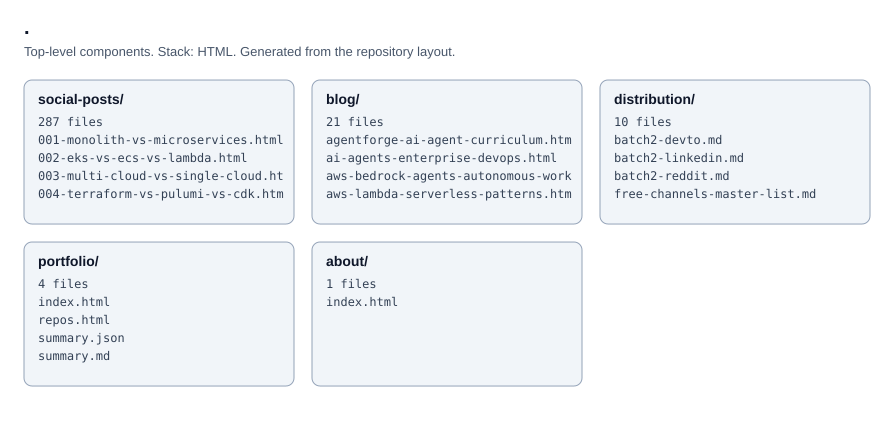

# kogunlowo123.github.io

Source for the personal site at https://kogunlowo123.github.io: an about page, a blog and supporting pages, configured through `_config.yml`. Edit the HTML files and push to publish.

<!-- project-structure -->
## Project structure

```text
├── about/
│   └── index.html
├── blog/
│   ├── agentforge-ai-agent-curriculum.html
│   ├── ai-agents-enterprise-devops.html
│   ├── aws-bedrock-agents-autonomous-workflows.html
│   ├── aws-lambda-serverless-patterns.html
│   ├── azure-sentinel-soc-automation.html
│   ├── cloud-disaster-recovery-terraform.html
│   ├── devsecops-pipeline-multi-cloud.html
│   ├── finops-multi-cloud-cost-optimization.html
│   └── … 13 more
├── distribution/
│   ├── batch2-devto.md
│   ├── batch2-linkedin.md
│   ├── batch2-reddit.md
│   ├── free-channels-master-list.md
│   ├── guest-post-pitches.md
│   ├── press-releases.md
│   ├── ready-to-post-devto.md
│   ├── ready-to-post-linkedin.md
│   └── … 2 more
├── portfolio/
│   ├── index.html
│   ├── repos.html
│   ├── summary.json
│   └── summary.md
├── social-posts/
│   ├── 001-monolith-vs-microservices.html
│   ├── 002-eks-vs-ecs-vs-lambda.html
│   ├── 003-multi-cloud-vs-single-cloud.html
│   ├── 004-terraform-vs-pulumi-vs-cdk.html
│   ├── 005-kubernetes-vs-serverless.html
│   ├── 006-arm-vs-x86-cloud.html
│   ├── 007-containers-vs-vms.html
│   ├── 008-api-gateway-vs-service-mesh.html
│   └── … 279 more
├── .editorconfig
├── .gitattributes
├── 404.html
├── CODEOWNERS
├── CONTRIBUTING.md
├── README.md
├── SECURITY.md
├── _config.yml
… (truncated)
```

<!-- architecture -->
## Architecture


